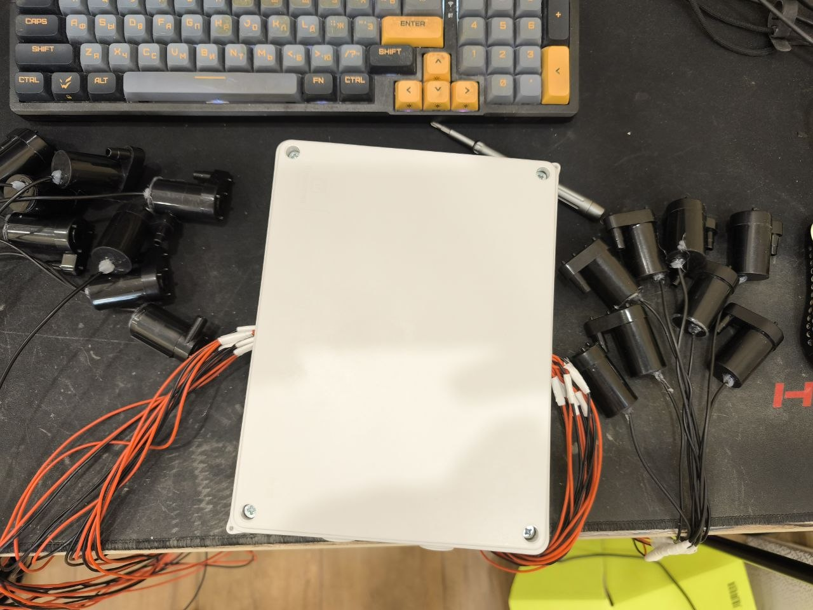
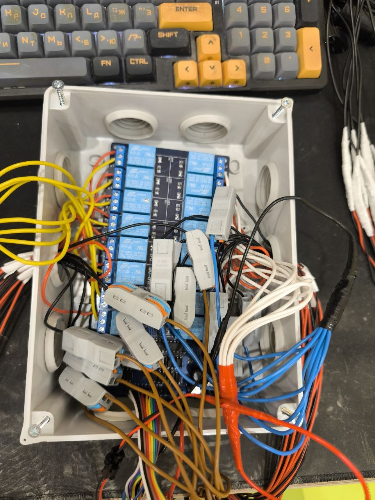

# GardenESP — автоматизированная система полива

## О проекте

**GardenESP** — автономная система автоматического полива растений на базе ESP32 с управлением 16 насосами через релейный модуль.

Система предназначена для работы от аккумуляторов, настройки через веб-интерфейс и автоматического запуска насосов по заданным интервалам.

Основная задача дальнейшего развития — добиться **надёжной автономной работы от аккумуляторов в течение 7 дней и более** без потери настроек и расписания полива.



## 1. Текущая аппаратная конфигурация

| Компонент | Характеристики |
|---|---|
| Контроллер | ESP32 ESP-WROOM-32 |
| Релейный модуль | 16 каналов, 5 В, Active LOW |
| Насосы | 16 × мини-помпа 5 В |
| Аккумуляторы | 3 × 18650, соединение 3S |
| Защита аккумуляторов | BMS 3S, 10 А |
| Преобразователь питания | LM2596, выход около 5 В |
| Интерфейс управления | Web UI через Wi-Fi Access Point |
| Хранилище настроек | NVS / Preferences |
| Среда разработки | Arduino IDE 2.3.6 |

### Текущие возможности

- [x] Управление 16 реле с ESP32.
- [x] Проверена работа Active LOW.
- [x] Включение насосов строго по одному.
- [x] Wi-Fi точка доступа ESP32.
- [x] Веб-интерфейс GardenESP.
- [x] Ручное включение и остановка насосов.
- [x] Настройка длительности полива.
- [x] Индивидуальные интервалы автополива.
- [x] Сохранение конфигурации в энергонезависимую память.
- [x] Загрузка конфигурации после перезапуска.
- [x] Обработка HTTP-запросов для Captive Portal.
- [ ] Проверка полной системы с подключёнными насосами.
- [ ] Проверка длительной автономной работы.

## 2. Известные ограничения

### 2.1. Высокое потребление энергии

Сейчас ESP32 постоянно поддерживает Wi-Fi точку доступа и выполняет веб-сервер.

Даже когда насосы выключены, система продолжает потреблять электричество.

Дополнительно энергию расходуют LM2596, релейная плата и BMS.

**Последствие:** автономность ограничена, и неделя работы от трёх аккумуляторов пока не гарантирована.

### 2.2. Сброс расписания после перезагрузки

Настройки сохраняются во Flash-памяти ESP32, но время следующего полива не восстанавливается.

После перезапуска начинается новый отсчёт интервала.

**Последствие:** после отключения питания автоматический полив может произойти позже запланированного.

### 2.3. Отсутствие контроля заряда аккумуляторов

ESP32 не измеряет напряжение аккумуляторной сборки.

Система не может предупреждать пользователя о низком заряде или заранее прекращать работу.

### 2.4. Отсутствие аппаратной защиты от непреднамеренного включения насосов

Некоторые GPIO ESP32 имеют особенности во время загрузки.

Также при переходе в Deep Sleep управляющие выводы могут менять состояние.

**Последствие:** нельзя считать насосы гарантированно выключенными при сбросе, загрузке или глубоком сне только на основании программного кода.

### 2.5. Отсутствие контроля фактической подачи воды

Система управляет временем включения насосов, но не знает, сколько воды действительно подано.

При пустом резервуаре, засорении трубки или отказе помпы полив может не состояться.

---

# 3. План развития (Roadmap)



## Этап 1. Энергосбережение — P0

**Приоритет: критический**

Цель: уменьшить потребление энергии в режиме ожидания.

### 3.1. Реализовать Deep Sleep

- [ ] Добавить режим глубокого сна ESP32.
- [ ] Отключать Wi-Fi перед переходом в сон.
- [ ] Реализовать пробуждение по встроенному RTC-таймеру.
- [ ] Восстанавливать рабочее состояние после пробуждения.
- [ ] Обеспечить выключение всех насосов перед сном.
- [ ] Не допускать непреднамеренного включения насосов во время сна и запуска.

**Ожидаемый результат:** ESP32 большую часть времени находится в энергосберегающем режиме и просыпается только при необходимости.

### 3.2. Добавить кнопку пробуждения

Предлагаемое оборудование:

- Кнопка без фиксации.
- Резистор 10 кОм.
- Свободный RTC-совместимый GPIO, например GPIO34.

Предлагаемая логика:

1. ESP32 находится в Deep Sleep.
2. Пользователь нажимает кнопку.
3. ESP32 просыпается.
4. Запускается Wi-Fi точка доступа `esp32-garden-1`.
5. Пользователь открывает веб-интерфейс.
6. Через заданное время бездействия ESP32 снова засыпает.

Задачи:

- [ ] Реализовать пробуждение кнопкой.
- [ ] Добавить таймер активности Wi-Fi.
- [ ] Добавить настройку времени активности, например 5–15 минут.
- [ ] Предусмотреть корректное продление сеанса при работе пользователя с веб-интерфейсом.
- [ ] Проверить защиту от многократных пробуждений при удержании кнопки.

### 3.3. Оптимизировать питание

- [ ] Измерить потребление системы в режиме ожидания.
- [ ] Измерить потребление ESP32 в Deep Sleep.
- [ ] Измерить собственное потребление LM2596.
- [ ] Измерить потребление релейной платы.
- [ ] Оценить замену LM2596 на DC-DC с низким током покоя.
- [ ] Добавить безопасный электронный ключ питания релейного модуля.
- [ ] Исключить обратное питание релейной платы через управляющие GPIO.

**Критерий готовности:** все насосы гарантированно выключены во сне, а измеренный ток ожидания позволяет оценить достижимость недельной автономности.

---

## Этап 2. Надёжное расписание — P0

**Приоритет: критический**

### 3.4. Добавить часы реального времени DS3231

Предлагаемое оборудование:

- Модуль RTC DS3231.
- Совместимый резервный источник питания для часов.

Задачи:

- [ ] Подключить DS3231 к ESP32 по I2C.
- [ ] Реализовать получение текущих даты и времени.
- [ ] Добавить установку времени через веб-интерфейс.
- [ ] Сохранять время последнего полива каждого насоса.
- [ ] Сохранять дату следующего полива.
- [ ] Восстанавливать расписание после перезапуска.
- [ ] Добавить обработку пропущенных поливов.
- [ ] Исключить повторный полив после неожиданной перезагрузки.

**Ожидаемый результат:** выключение питания не приводит к потере календарного расписания.

### 3.5. Улучшить планировщик полива

- [ ] Поддерживать независимое расписание для каждого насоса.
- [ ] Реализовать очередь ожидающих поливов.
- [ ] Гарантировать работу максимум одного насоса одновременно.
- [ ] Предусмотреть приоритет ручного запуска.
- [ ] Добавить минимальный интервал между последовательными включениями насосов.
- [ ] Сохранять состояние незавершённых операций с учётом износа Flash.
- [ ] Определить правила восстановления при прерванном поливе.

---

## Этап 3. Безопасность и отказоустойчивость — P0

**Приоритет: критический**

### 3.6. Защита релейного модуля и насосов

- [ ] Проверить GPIO4 и GPIO5 на нежелательные переключения при загрузке ESP32.
- [ ] При необходимости переназначить проблемные GPIO.
- [ ] Добавить аппаратное гарантированное выключение релейного модуля.
- [ ] Проверить безопасную последовательность включения и выключения питания.
- [ ] Добавить защитные диоды для двигателей насосов.
- [ ] Проверить просадки напряжения во время запуска насосов.
- [ ] Установить подходящий предохранитель для силовой цепи.
- [ ] Проверить допустимый ток проводников и распределительных соединений.

### 3.7. Защита от зависаний

- [ ] Использовать аппаратный или программный watchdog ESP32.
- [ ] Обеспечить безопасное выключение насосов при ошибках.
- [ ] Реализовать ограничение максимального времени работы одного насоса.
- [ ] Добавить журнал ошибок.
- [ ] Проверить восстановление системы после аварийной перезагрузки.

### 3.8. Контроль аккумуляторов

- [ ] Добавить измерение напряжения сборки 3S.
- [ ] Использовать подходящий делитель напряжения или монитор аккумулятора.
- [ ] Добавить индикацию низкого заряда в веб-интерфейсе.
- [ ] Предусмотреть безопасное поведение при низком напряжении.
- [ ] Проверить работу BMS при разряде и восстановлении питания.
- [ ] Измерить фактическую ёмкость аккумуляторов Hangliang 18650.

**Важно:** заявленная ёмкость 8000 мА·ч для аккумулятора формата 18650 не должна использоваться в расчётах автономности без независимой проверки.

---

## Этап 4. Улучшение веб-интерфейса — P1

**Приоритет: высокий**

### 3.9. Отображение состояния системы

- [ ] Добавить отображение заряда аккумуляторов.
- [ ] Добавить дату и время ESP32.
- [ ] Показывать следующий запланированный полив.
- [ ] Показывать оставшееся время работы насоса.
- [ ] Показывать активный режим: настройка, полив или подготовка ко сну.
- [ ] Добавить информацию о последнем успешном поливе.

### 3.10. Управление энергосбережением

- [ ] Добавить настройку времени активности Wi-Fi.
- [ ] Добавить кнопку «Перейти в режим сна».
- [ ] Добавить режим обслуживания с временным отключением автополива.
- [ ] Показывать время следующего пробуждения.

### 3.11. Улучшение удобства использования

- [ ] Улучшить Captive Portal для Android и iOS.
- [ ] Добавить возможность переименования насосов.
- [ ] Добавить ручную настройку времени и расписания.
- [ ] Добавить экспорт и импорт настроек.
- [ ] Добавить подтверждение опасных операций.
- [ ] Обеспечить корректную работу интерфейса на смартфонах.

### 3.12. Безопасность веб-управления

- [ ] Заменить стандартный пароль Wi-Fi на индивидуальный.
- [ ] Добавить защиту команд управления от неавторизованных запросов.
- [ ] Проверять все входящие значения API.
- [ ] Добавить ограничения на количество и длительность запросов.
- [ ] Исключить доступ к управлению насосами из недоверенных сетей.

---

## Этап 5. Контроль фактического полива — P2

**Приоритет: средний**

### 3.13. Контроль уровня воды

Добавить датчик уровня воды в резервуар.

Возможности:

- [ ] Определять недостаточный уровень воды.
- [ ] Запрещать полив при пустом резервуаре.
- [ ] Отображать состояние резервуара в веб-интерфейсе.
- [ ] Регистрировать ошибки недостатка воды.

### 3.14. Контроль объёма полива

Возможные варианты реализации:

1. Калибровка каждого насоса по производительности.
2. Использование датчика расхода воды, подходящего для малых расходов.
3. Контроль фактического объёма отдельным измерительным устройством.

Задачи:

- [ ] Добавить индивидуальную производительность насосов.
- [ ] Поддержать настройку объёма полива в миллилитрах.
- [ ] Рассчитывать длительность включения на основании калибровки.
- [ ] При наличии датчиков контролировать фактическую подачу воды.
- [ ] Обнаруживать возможные неисправности насосов.

---

## Этап 6. Мониторинг и диагностика — P2

### 3.15. История полива

- [ ] Сохранять дату запуска насоса.
- [ ] Сохранять длительность полива.
- [ ] Различать ручные и автоматические запуски.
- [ ] Регистрировать успешное завершение и аварийные остановки.
- [ ] Ограничивать объём записей и износ Flash-памяти.

### 3.16. Диагностика оборудования

- [ ] Отображать напряжение питания.
- [ ] Отображать причины последних перезагрузок.
- [ ] Добавить тестирование каждого реле.
- [ ] Добавить режим диагностики насосов.
- [ ] Отображать состояние датчиков и RTC.

---

# 4. Предлагаемая архитектура прошивки

Для упрощения дальнейшей разработки рекомендуется разделить проект на независимые модули.

```text
GardenESP/
├── GardenESP.ino
├── web_ui.h
├── config.h
├── relay_controller.h
├── relay_controller.cpp
├── pump_manager.h
├── pump_manager.cpp
├── scheduler.h
├── scheduler.cpp
├── power_manager.h
├── power_manager.cpp
├── rtc_manager.h
├── rtc_manager.cpp
├── storage.h
├── storage.cpp
├── web_server.h
└── web_server.cpp
```

### Назначение модулей

| Модуль | Ответственность |
|---|---|
| `relay_controller` | Управление GPIO и реле |
| `pump_manager` | Запуск, остановка, защита и очередь насосов |
| `scheduler` | Автоматическое расписание |
| `power_manager` | Deep Sleep, пробуждение и питание |
| `rtc_manager` | Работа с DS3231 |
| `storage` | Сохранение настроек и состояния |
| `web_server` | HTTP API и веб-интерфейс |
| `config` | Общие настройки и распиновка |

Разделение поможет тестировать компоненты независимо и не нарушать рабочую логику реле при изменении веб-интерфейса или расписания.

---

# 5. Приоритеты разработки

| Приоритет | Улучшение | Статус |
|---|---|---|
| P0 | Гарантированное выключение реле | Запланировано |
| P0 | Измерение энергопотребления | Запланировано |
| P0 | Deep Sleep ESP32 | Запланировано |
| P0 | Пробуждение кнопкой | Запланировано |
| P0 | Безопасное отключение питания релейного блока | Запланировано |
| P0 | Восстановление расписания после перезапуска | Запланировано |
| P0 | Тестирование автономности | Запланировано |
| P1 | Контроль напряжения аккумуляторов | Запланировано |
| P1 | Улучшение веб-интерфейса | Запланировано |
| P1 | События и диагностика | Запланировано |
| P2 | Контроль уровня воды | Запланировано |
| P2 | Контроль объёма полива | Запланировано |
| P2 | Журнал поливов | Запланировано |

---

# 6. Критерии готовности автономной версии

Система считается готовой к длительной автономной эксплуатации, когда:

- [ ] Все 16 насосов проверены с реальной нагрузкой.
- [ ] Одновременно может работать только один насос.
- [ ] Ни один насос не включается самопроизвольно при загрузке, сне или отключении питания.
- [ ] Настройки сохраняются после полного разряда или отключения аккумуляторов.
- [ ] Расписание восстанавливается после перезагрузки.
- [ ] ESP32 корректно просыпается по таймеру.
- [ ] ESP32 просыпается по кнопке и предоставляет веб-интерфейс.
- [ ] Wi-Fi автоматически отключается после завершения настройки.
- [ ] Система правильно реагирует на низкий заряд.
- [ ] Измерено фактическое энергопотребление.
- [ ] Проведён непрерывный тест автономной работы продолжительностью минимум 7 дней.
- [ ] За время теста не обнаружены пропущенные поливы, самопроизвольные включения или зависания.

---

# 7. Долгосрочная цель

Разработать автономный контроллер полива, который:

- управляет 16 независимыми каналами;
- работает от аккумуляторов не менее одной недели;
- не требует постоянного подключения к Wi-Fi;
- позволяет настраивать систему со смартфона;
- сохраняет расписание после отключений питания;
- контролирует состояние аккумуляторов;
- безопасно управляет насосами;
- может расширяться дополнительными датчиками.

**Главный принцип развития:** сначала надёжность и электрическая безопасность, затем энергосбережение, после этого дополнительные функции и улучшение интерфейса.